<div align="center">

# Sistema Académico UCA V2

Plataforma de gestión académica para la Universidad Católica «Nuestra Señora de la Asunción», Unidad Pedagógica de Caacupé. Tiene backend en **FastAPI**, frontend web en **React** y una app móvil en **Expo**, con portales para los roles **Alumno**, **Profesor** y **Administrador**.


</div>

> [!NOTE]
> **Repositorio principal y oficial:** [github.com/dual-devs0/sistema-academico](https://github.com/dual-devs0/sistema-academico).
> Este repositorio es una copia personal que muestro en mi portafolio. Incluye el rediseño visual más reciente.

---

##  Demo en producción

| | |
|---|---|
| **Frontend web** | [sistema-academico-alpha.vercel.app](https://sistema-academico-alpha.vercel.app/login), alojado en **Vercel** |
| **API (backend)** | `uca-v2-backend.onrender.com`, alojada en **Render** (la configuración está en [`render.yaml`](render.yaml)) |
| **Base de datos** | PostgreSQL en **Supabase** |

**Accesos de prueba**

| Rol | Usuario | Contraseña |
|---|---|---|
| Alumno | `12345678` | `Alumno1234!` |
| Profesor | `prof@uca.edu.py` | `Profesor1234!` |
| Administrador | `admin@uca.edu.py` | `Admin1234!` |

El acceso de administrador está en `/admin`. El backend corre en el plan gratuito de Render, así que el primer pedido puede tardar unos segundos mientras el servicio arranca.

##  Funcionalidades

**Alumno**
- **Dashboard:** promedio, asistencia, créditos y cuota pendiente, más las calificaciones por materia y la agenda del día.
- **Asistencia por QR:** el alumno escanea con la cámara el código que proyecta el profesor. Usa `BarcodeDetector` nativo y, si el navegador no lo soporta, jsQR. El código expira y tiene validación de duplicados.
- **Cursos:** temario, asistencia por materia con selector de período y desglose de calificaciones.
- **Boleta:** historial por semestre y PDF descargable. Cada boleta lleva un **sello digital HMAC-SHA256** con un QR que se verifica públicamente en `GET /boleta/verificar/{codigo}`.
- **Inscripción:** el servidor valida las correlatividades, el cupo, la mora y el máximo de créditos.
- **Mi progreso** (malla curricular), **expediente**, **graduación**, **equivalencias**, **becas** y **pasantías**.
- **Mis cuotas:** descuentos por beca, pago online con **Stripe Checkout** y comprobantes.
- Trámites, biblioteca de apuntes y calendario académico.

**Profesor**
- Dashboard con aprobación, asistencia promedio, alertas de inasistencia y agenda.
- **Generación del QR** de asistencia en vivo y edición de la asistencia por fecha.
- **Gestión de calificaciones** con un motor de notas por puntos: pesos configurables por materia (20/20/10/50 por defecto), tres oportunidades de final y exportación a CSV.
- Mis materias (activas, histórico y agenda), estadísticas y programa de clases.

**Administrador**
- Usuarios y roles, asignaciones de profesores, malla curricular y correlatividades.
- Finanzas: conceptos de arancel, cuotas, pagos, becas y comprobantes con facturación electrónica (guarani.app).
- Inscripciones, expedientes, graduación, pasantías, equivalencias, trámites, reportes y ajustes globales.
- Importación de eventos del calendario desde un PDF, que se procesa con **Gemini**.

**Transversal**
- Autenticación JWT con el access token en el body y el refresh en una cookie httpOnly, **CSRF double-submit**, **rate limiting** propio y auditoría de cambios.
- Notificaciones push (Web Push/VAPID), envío de emails con proveedor intercambiable (Resend, SendGrid o SMTP) y almacenamiento de archivos en Cloudflare R2.
- **App móvil** (Expo): cursos, horario, escáner QR, exámenes y cuenta.

##  Capturas

Las capturas se tomaron en local con datos ficticios generados por los scripts de seed.

| Login | Dashboard del alumno |
|---|---|
|  | 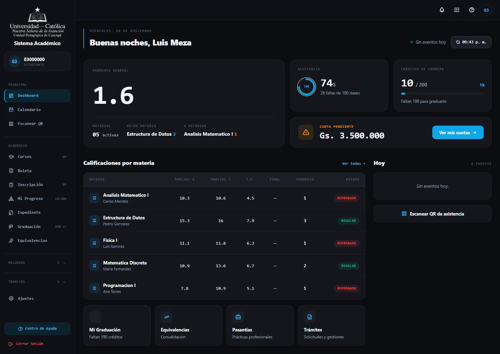 |

| Cursos · Asistencia | Registrar asistencia (QR) |
|---|---|
| 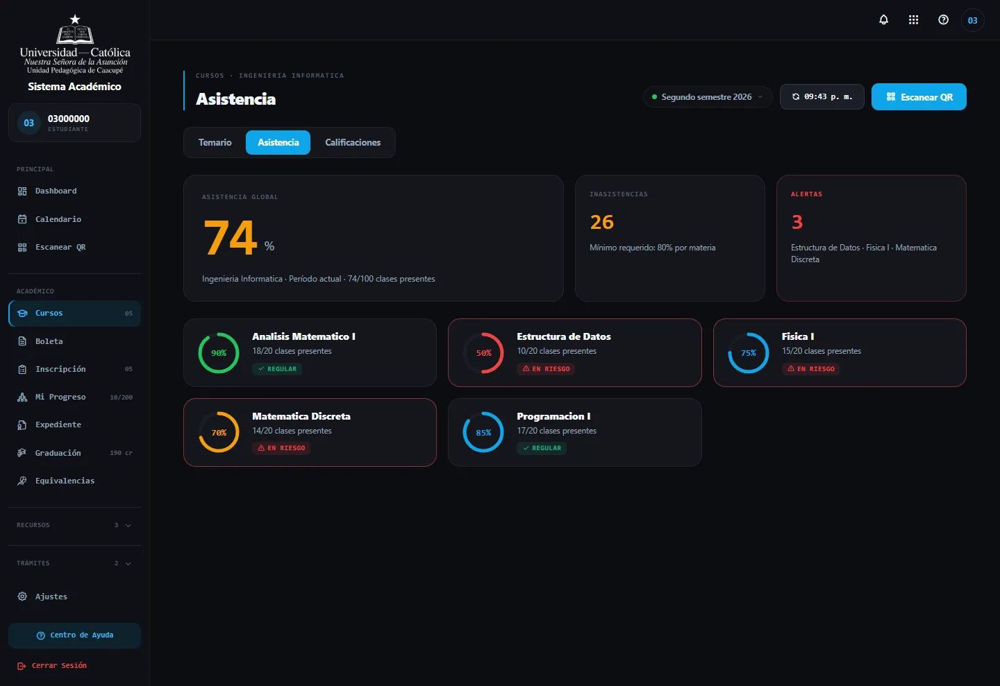 | 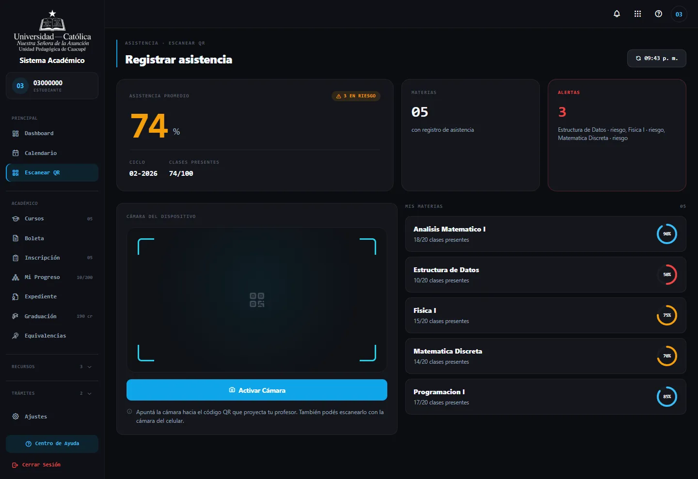 |

| Boleta con sello digital | Mis cuotas |
|---|---|
| 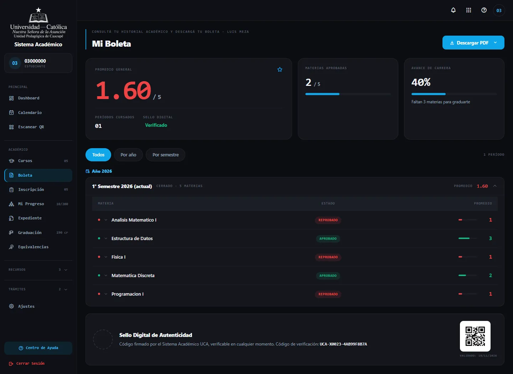 | 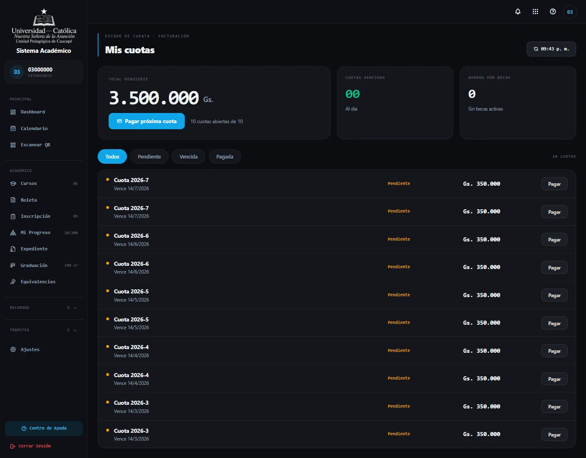 |

| Mi progreso | Inscripción |
|---|---|
| 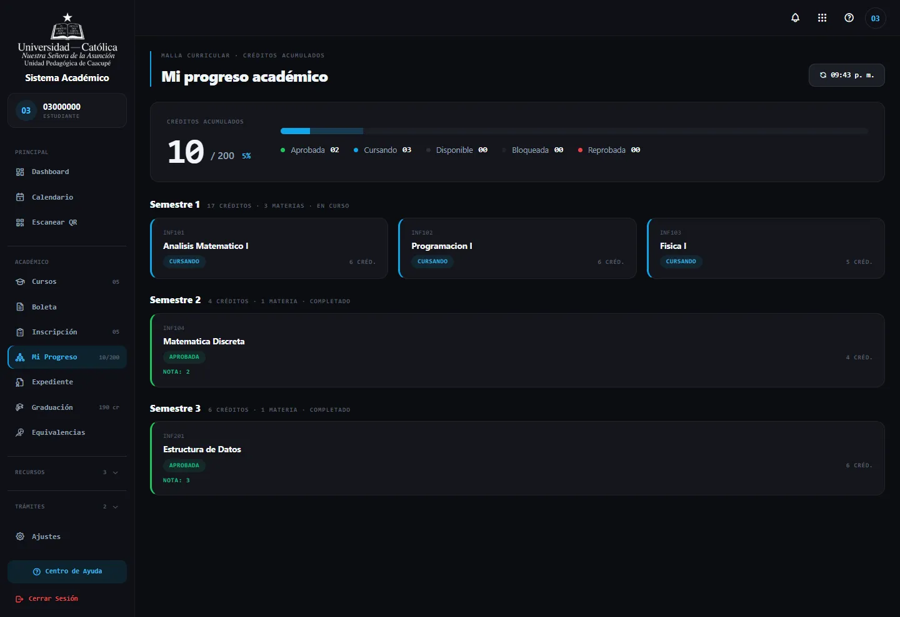 | 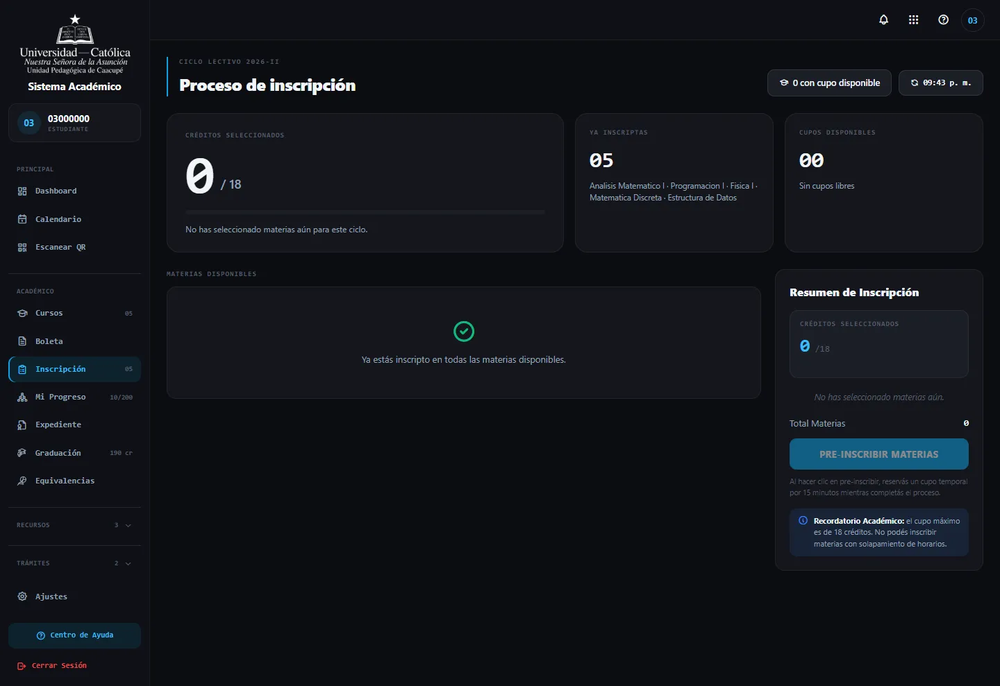 |

| Dashboard del profesor | Gestión de calificaciones |
|---|---|
| 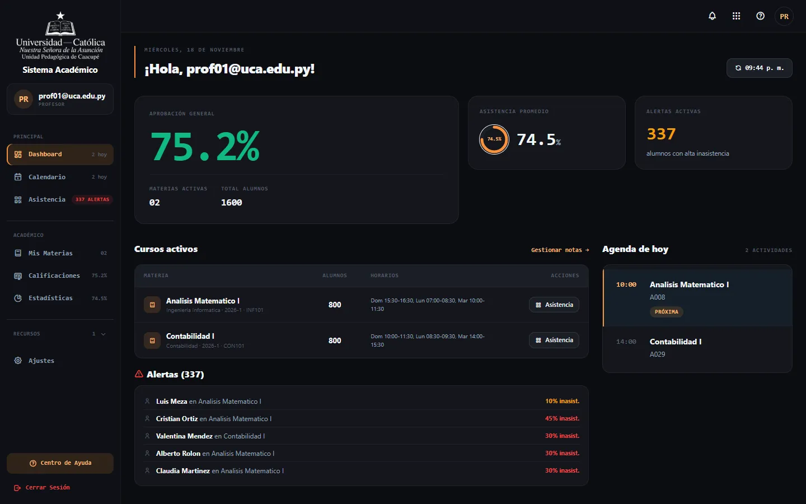 | 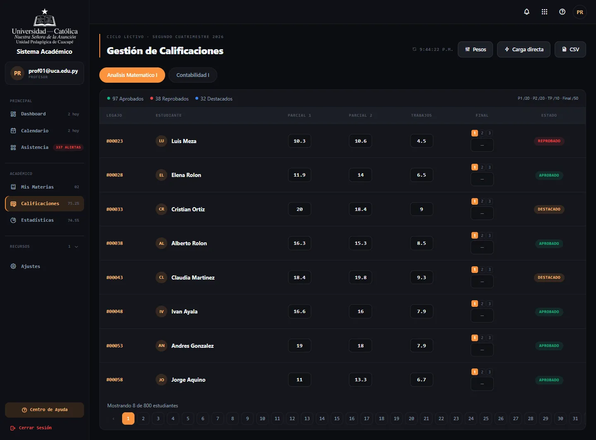 |

| Panel de administración | Gestión de usuarios |
|---|---|
| 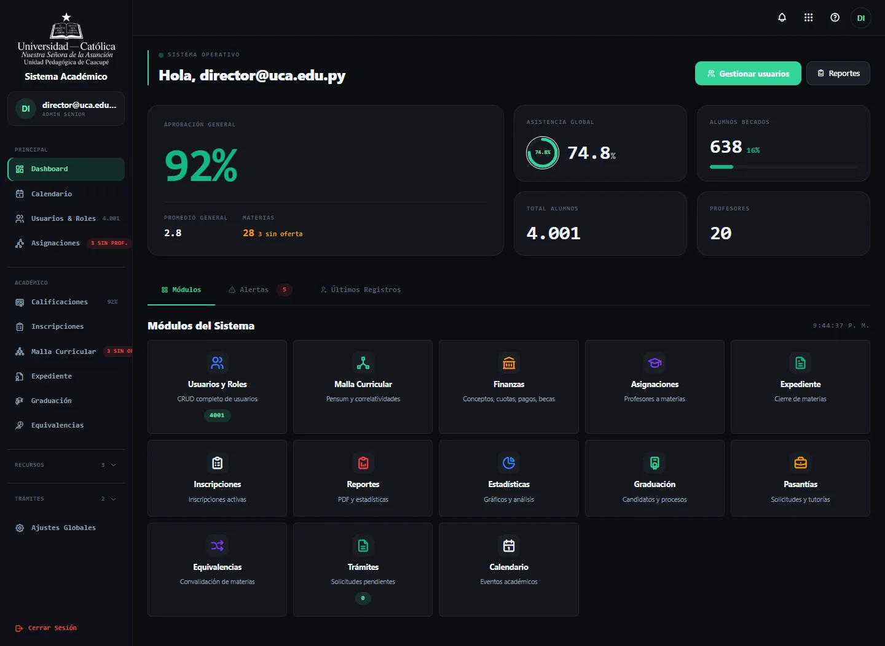 | 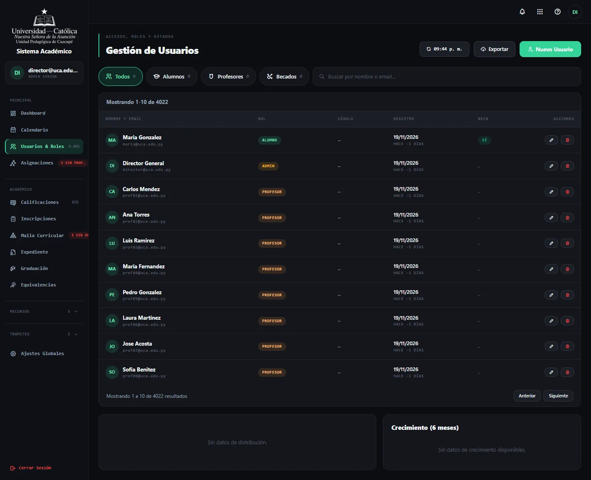 |

Hay más capturas en [`docs/screenshots/`](docs/screenshots): mis materias del profesor y el panel financiero.

##  Arquitectura

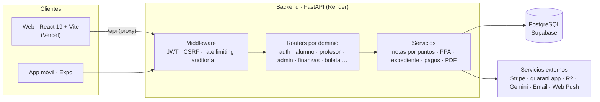

- **Backend:** 29 routers por dominio en `backend/app/routers`. La lógica de negocio está en `backend/app/services`, por ejemplo el promedio final centralizado en `puntajes_utils.py` y el PDF de la boleta con WeasyPrint. Los modelos son SQLAlchemy y las migraciones se manejan con **Alembic** (42 versiones).
- **Frontend:** SPA con React Router. Usa un cliente HTTP propio (`src/lib/api.ts`) que reintenta con el refresh token y reenvía el header CSRF, más tokens de diseño por rol en `src/styles/design-tokens.css`.
- **Seguridad:** control de acceso por rol en cada endpoint. La auditoría del 2026-07-24 está documentada en [`docs/auditorias/`](docs/auditorias).

##  Tecnologías

| Capa | Tecnología |
|---|---|
| Backend | Python, FastAPI, SQLAlchemy 2, Alembic, Pydantic 2, Uvicorn |
| Base de datos | PostgreSQL (Supabase). SQLite solo para tests y demo local |
| Frontend web | React 19, TypeScript, Vite 8, Tailwind CSS 4, React Router 7, Recharts, Tabler Icons |
| Mobile | Expo SDK 57, React Native, expo-router, NativeWind |
| PDF y QR | WeasyPrint, ReportLab, qrcode, jsQR, html2pdf.js |
| Integraciones | Stripe, guarani.app (facturación), Cloudflare R2 (boto3), Google Gemini, Web Push (pywebpush) |
| Tests y CI | pytest, Vitest + Testing Library, GitHub Actions |

##  Estructura

```text
sistema-academico/
├── backend/
│   ├── app/
│   │   ├── routers/        # endpoints por dominio
│   │   ├── services/       # lógica de negocio (notas, expediente, pagos, PDF…)
│   │   ├── models/         # modelos SQLAlchemy
│   │   ├── schemas/        # esquemas Pydantic
│   │   ├── middleware/     # CSRF y otros
│   │   └── main.py
│   ├── alembic/            # migraciones
│   ├── scripts/            # seeds de datos ficticios
│   ├── tests/              # 38 archivos de tests (pytest)
│   └── requeriments.txt
├── frontend/
│   └── src/
│       ├── pages/          # vistas por rol
│       ├── components/     # Layout, paneles y piezas comunes
│       ├── services/       # llamadas a la API por módulo
│       ├── lib/api.ts      # cliente HTTP (JWT + refresh + CSRF)
│       └── styles/         # design tokens
├── mobile/                 # app Expo (expo-router)
├── docs/                   # arquitectura, API, modelo de datos, deploy, auditorías
├── render.yaml             # deploy del backend en Render
└── .github/workflows/      # CI: tests de backend y lint, tests y build del frontend
```

##  Correr en local

**Requisitos:** Python 3.11 o superior y Node.js 20 o superior. PostgreSQL para un entorno real; para probar alcanza con SQLite.

### 1. Backend

```powershell
cd backend
python -m venv venv
.\venv\Scripts\Activate.ps1
pip install -r requeriments.txt
copy .env.example .env      # completar DATABASE_URL, JWT_SECRET, etc.
alembic upgrade head
uvicorn app.main:app --reload --port 8000
```

La guía completa, con las variables de entorno y la instalación de GTK para WeasyPrint en Windows, está en [`docs/web-system/INSTALACION.md`](docs/web-system/INSTALACION.md).

### Demo rápida con SQLite y datos ficticios

Sirve para probar sin Postgres. `DATABASE_URL` definida en la terminal tiene prioridad sobre el `.env`.

```powershell
cd backend
$env:DATABASE_URL = "sqlite:///./demo.db"
$env:TEST_DATABASE_URL = $env:DATABASE_URL
$env:PYTHONPATH = "."
python -c "import app.main; from app.database import Base, engine; Base.metadata.create_all(bind=engine)"
python scripts/seed_pensum_piloto.py
python scripts/seed_masivo.py
python scripts/seed_restante.py
uvicorn app.main:app --port 8000
```

Los seeds crean, entre otros, un administrador `director@uca.edu.py` / `Director1234!`, profesores `prof01@uca.edu.py` / `Profesor1234!` y alumnos con cédula (por ejemplo `03000000`) / `Alumno1234!`. Todos los datos son ficticios.

### 2. Frontend

```powershell
cd frontend
npm install
npm run dev                 # http://localhost:5173
```

Vite reenvía `/api` al backend en `http://127.0.0.1:8000`. Para usar otro puerto se define `API_PROXY_TARGET`, por ejemplo `$env:API_PROXY_TARGET = "http://127.0.0.1:8010"`.

### 3. App móvil (opcional)

```powershell
cd mobile
npm install
npx expo start
```

### Tests

```powershell
cd backend;  python -m pytest -q
cd frontend; npm run test:run
```

Estado actual: el backend pasa 399 tests. Los 4 tests de PDF necesitan las librerías nativas de GTK para WeasyPrint y en Windows fallan si no están instaladas. El frontend pasa 20 de 20 tests y el build compila sin errores.

##  Despliegue

- **Frontend:** Vercel. [`frontend/vercel.json`](frontend/vercel.json) reescribe `/api/*` hacia el backend.
- **Backend:** Render, con [`render.yaml`](render.yaml): `alembic upgrade head` en el build y `uvicorn` en el start.
- **Base de datos:** Supabase (PostgreSQL).
- Guía paso a paso en [`docs/web-system/GUIA_DEPLOY_PRODUCCION.md`](docs/web-system/GUIA_DEPLOY_PRODUCCION.md).

##  Documentación

- [Arquitectura](docs/web-system/ARQUITECTURA.md), [referencia de la API](docs/web-system/API_REFERENCE.md), [modelo de datos](docs/web-system/MODELO_DATOS.md) y [variables de entorno](docs/web-system/VARIABLES_ENTORNO.md).
- [Estado de las fases de desarrollo](docs/web-system/ESTADO_FASES.md) y [documentación técnica total](docs/documentacion-tecnica/DOCUMENTACION_TECNICA_TOTAL.md).
- [App móvil](docs/app-mobile-system/PLAN_DESARROLLO_MOBILE.md).

##  Versiones

| Versión | Fecha | Cambios |
|---|---|---|
| **2.1** | 2026-11 | Rediseño visual con jerarquía por foco: un KPI dominante por pantalla, encabezado de una línea con refresh integrado y sidebar con grupos colapsables. Aplicado a los dashboards, Boleta, Mi progreso, Graduación, Cursos/Asistencia, Escanear QR, Mis cuotas e Inscripción; el resto de las vistas se migra en las próximas versiones. |
| **2.0** | 2026-08 | Motor de notas por puntos, sello digital de la boleta, pagos con Stripe, facturación electrónica, app móvil y auditoría de seguridad. |
| 1.x | 2026-06 / 07 | Primeras fases: usuarios y roles, materias, asistencia, calificaciones y calendario. |

##  Autor

<table>
  <tr>
    <td></td>
    <td>
      <strong>Victor Emmanuel Cabrera Sosa</strong><br>
      <a href="https://github.com/vecs0">vecs0 · github.com/vecs0</a>
    </td>
  </tr>
</table>

##  Licencia

Distribuido bajo la licencia MIT. Ver [`LICENSE`](LICENSE).
